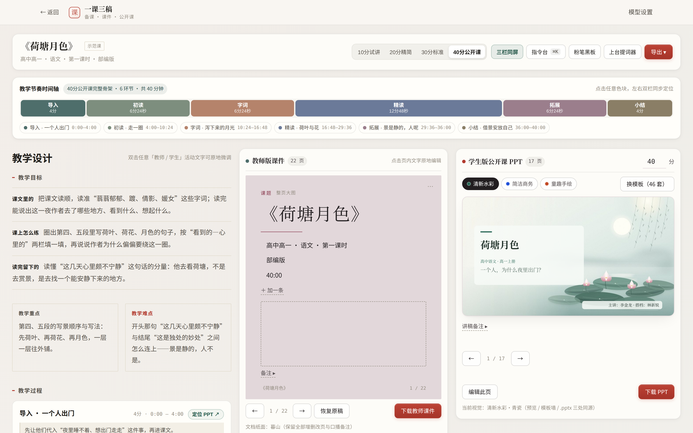
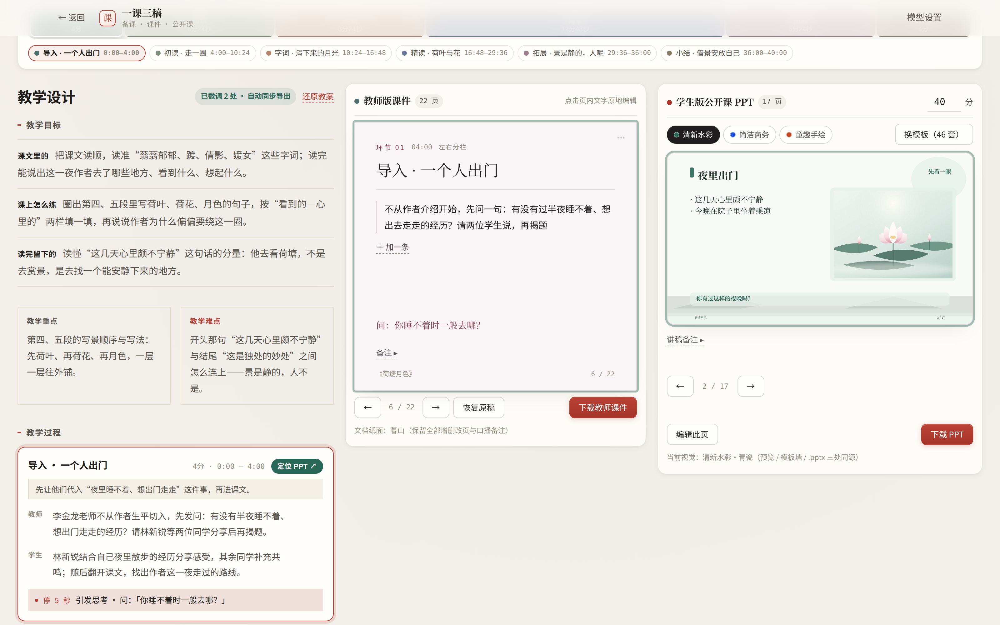
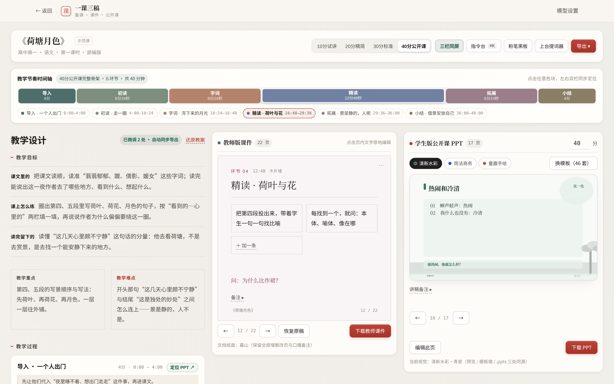
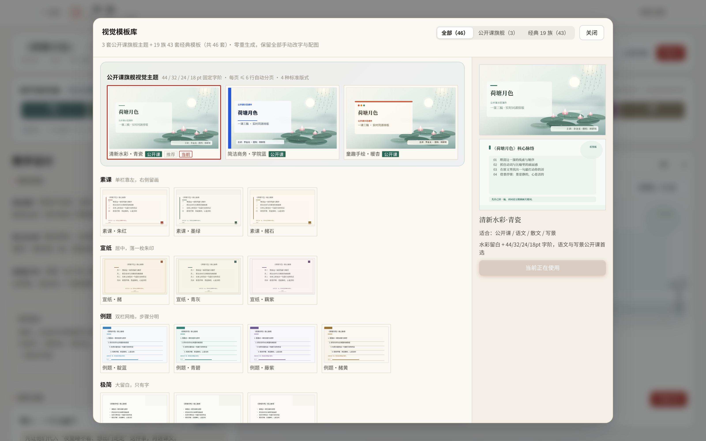
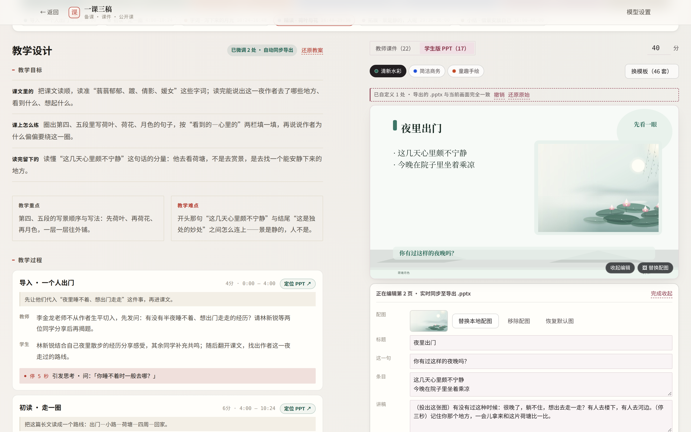
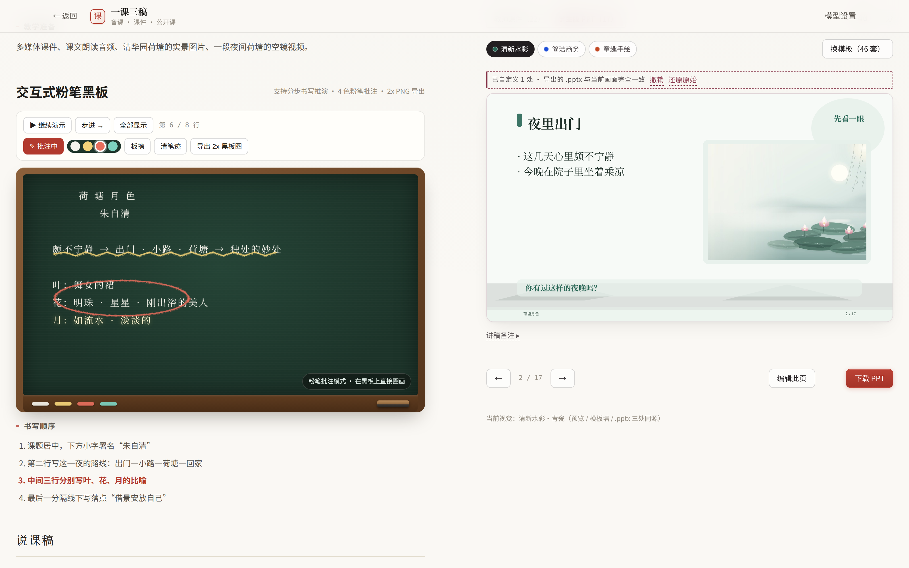
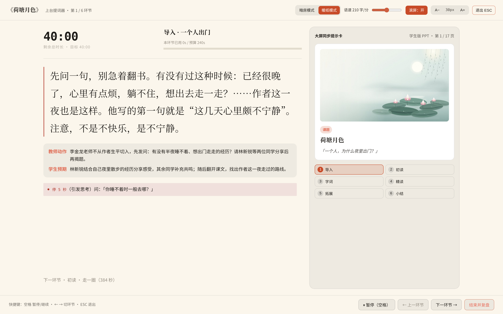
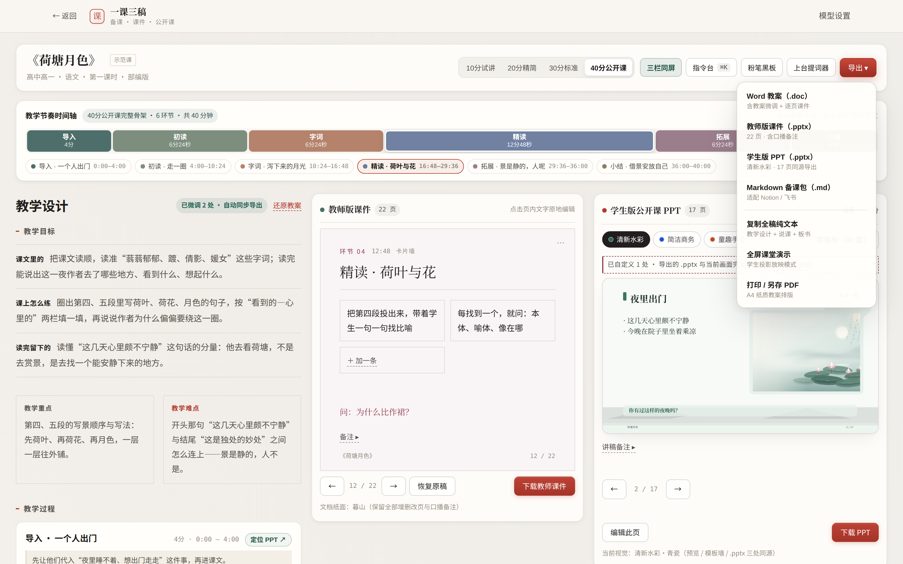
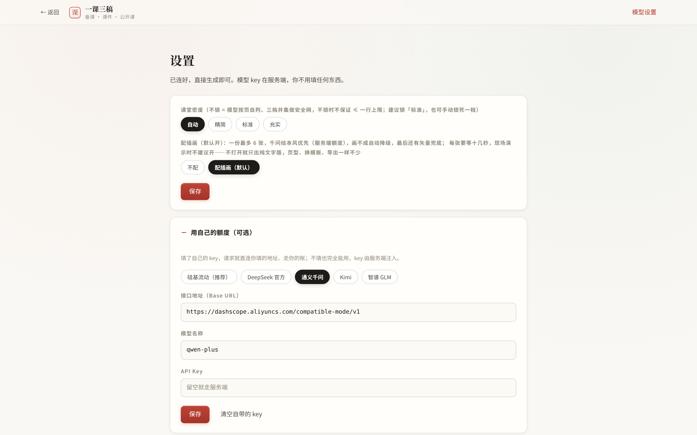

# 《一课三稿》2026 Qoder 高校创造力大赛（StudyHack 赛道）参赛功能介绍

参赛团队：李金龙（主讲 / 参赛者）、林新锐（搭档 / 参赛者）

> **示范课例**：部编版高中语文高一 · 朱自清《荷塘月色》（第一课时 · 40 分钟公开课）  
> **实拍规格**：1600×1000 视口 · Retina 2x（3200×2000px）· 纯静态构建（`dist/`）实拍 · 统一浅色学术工作台主题 · 零 API Key 零报错

「一课三稿」聚焦中小学教师与师范生最真实的备课痛点：输入课题与课时后，一次同步生成**可原地编辑的教学设计、教师版课件与学生版公开课 PPT**，并把老师每一处手动改字、单页换图与主题切换 100% 同源写入导出的 Word / `.pptx` / Markdown 文件。以下以李金龙主讲、林新锐搭档的《荷塘月色》公开课为主线，逐一展示全部 12 项核心功能。

---

## 一、首页 Editorial Studio 备课输入（含 10/20/30/40 分钟胶囊）

传统备课工具往往一上来就铺满几十个表单项，让老师在真正构思教学之前就被繁琐配置消耗掉精力，而教资试讲、微课精讲与公开课对课时的结构要求又截然不同。在「一课三稿」首页，李金龙只需在磨砂浮起的一体化输入框中写下《荷塘月色》的课题与授课意图，顺手点选下方「10分试讲 / 20分精简 / 30分标准 / 40分公开课」胶囊（或直接填写任意 10–45 分钟时长），有课文原文时再展开折叠抽屉粘贴或拍照导入即可。如果评委或老师想零门槛体验完整工作台，也无需配置任何 API Key，直接点击下方三列精选示范课画廊中的《荷塘月色》就能在纯静态页面上秒开整套备课包。这样一来，备课起点从「填表」回归到「一句话说清今天要上什么课」，大幅缩短了从灵感落笔到成稿预览的第一公里。

---

## 二、三稿结果页（左教案 / 中教师版课件 / 右学生版 PPT 三栏联动）

老师备课时最头疼的割裂感，在于教案躺在 Word 里、讲课思路和备注藏在教师课件里、投影画面又另起一份学生 PPT，改一处就要三头手动对齐。进入《荷塘月色》工作台后，宽屏默认展开「三栏同屏」视图，左侧呈现完整教学设计与板书说课，中间固定停靠 22 页教师版课件，右侧实时渲染 17 页学生版公开课 PPT，顶栏还可一键切换为「双栏聚焦」以放大单侧画布精修。三份文稿全部支持老师点击即改，李金龙在左侧调整教案或在中间增删教师课件要点、右侧切换主题并署名「主讲：李金龙 · 搭档：林新锐」时，无需在多个软件窗口间反复跳转。整节课的「教案逻辑—讲台提示—课堂投屏」由此在同一视野里形成闭环，改稿不再漏项，备课效率与三稿一致性成倍提升。

---

## 三、教案卡片「定位 PPT 跳转」与原地微调

AI 生成的初稿只能算好用的底稿，真正站上公开课讲台时，老师一定会把提问对象、课堂口吻和互动细节改成贴合自己班级的版本，同时还想立刻核对这一段对应哪几页课件。在左侧教学过程的每一张环节卡片中，李金龙只需双击「教师」或「学生」活动文字，就能原地修改为「请林新锐等两位同学分享后再揭题」「林新锐结合自己夜里散步的经历分享感受」等真实课堂安排，失焦或按 `⌘+Enter` 即自动保存并点亮「已微调 2 处 · 自动同步导出」提示。随后轻点卡片右上角的「定位 PPT ↗」按钮，中间教师版课件与右侧学生版 PPT 会同步翻到该环节对应的「导入 · 一个人出门」与「夜里出门」页面并亮起青瓷同步边框。通过原地微调与一键定位联动，老师既拥有对教案文字的完全掌控权，改完的内容也会原封不动地带入 Word、Markdown、复制全稿与提词器中。

---

## 四、教学节奏时间轴（点色块左侧滚动 + 右侧翻页）

一节 40 分钟的公开课最怕「前松后紧、精读讲不完」，而在纯文字教案里老师很难一眼看出各环节占比是否合理，也难在临时压缩为 10 分钟试讲或 20 分钟精简课时快速重排。工作台顶部将整节课映射为按分钟比例伸缩的莫兰迪色教学节奏时间轴，老师在上方切换 10/20/30/40 分钟四档课型时，各色块会带弹簧过渡动画重新分配时长，点击任意一个色块（例如「精读 · 荷叶与花 16:48–29:36」）即可让左侧教案平滑滚动高亮至该环节，同时驱动中间教师版课件与右侧学生版 PPT 同步翻至精读页面。这样直观的时间骨架让李金龙与林新锐在磨课时一眼就能抓住 12 分 48 秒的核心精读权重，无论是日常核对节奏还是赛场临时缩减试讲时长，都能秒级重排、精准控时。

---

## 五、视觉模板墙（19 族 43 套 + 三套公开课主题）

同一篇课文在不同教研场景下需要截然不同的视觉气质，但传统 PPT 一旦换模板往往字号错乱、文字出框，辛辛苦苦改好的字和配图还要重新排版。点击学生版栏上的「换模板（46 套）」，居中弹出的视觉模板墙将全新打造的「清新水彩」「简洁商务」「童趣手绘」三套公开课旗舰主题置顶呈现，下方完整保留 19 族 43 套经典教学模板，并支持按分类筛选与右侧封面/内页双画布实时预览。老师只需点选心仪套系，整套《荷塘月色》就会在零网络请求、零模型重生成的前提下瞬间换肤，所有手动修改的文字、署名的「主讲：李金龙 · 搭档：林新锐」以及自定义配图全部完好保留。借助与预览、模板墙、导出 `.pptx` 完全同源的排版引擎，老师可以放心尝试多种风格，做到所见即所得、零返工出片。

---

## 六、封面插画（满版铺底、字压图）

很多自动生成的课件封面要么是单调白底配几行黑字，要么把配图生硬地塞进角落小框里，在公开课大屏投影时毫无沉浸氛围，甚至因为字图冲突导致插画干脆被隐藏。在「一课三稿」中，系统为《荷塘月色》等内置示范课预置了 16:9 无字水彩与几何插画，并在排版引擎底层确保封面插画无条件满版铺底、文字卡片与署名浮压其上，确保高对比度可读性与画面完整性兼得。老师切至「双栏聚焦」视图即可大画幅检视封面效果：月色荷塘水彩铺满整页 16:9 画面，左侧磨砂纸面卡片清晰托起课题「荷塘月色」、学段「高中语文 · 高一上册」与导语，右下角浅色衬底稳稳呈现「主讲：李金龙 · 搭档：林新锐」。这张封面在纯静态环境下 0 秒加载，导出 PowerPoint 时也会以完全一致的满版层级写入 `.pptx`，一开场就能立住公开课的审美格调。

---

## 七、学生版单页换图与撤销

老师备课时常常手头有更贴合本班学情的实景照片、教材扫描图或自制示意图，却苦于在线课件工具只能全盘接受默认配图，或者换错图后不好恢复原样。在学生版公开课 PPT 中，李金龙只需直接点击任意一页画面（或点击画面右下角浮出的「替换配图」胶囊）即可展开本页编辑抽屉，在首行「配图」区一键上传或替换本地图片，系统会自动完成 16:9 居中裁切与压缩并即时呈现在画面上。每次换图或改字都会记入最多 40 步的撤销栈，画布上方同步亮出「已自定义 1 处 · 导出的 .pptx 与当前画面完全一致」提示条，随时可以单步「撤销」、单页「恢复默认图」或「移除配图」，切换 46 套模板时自定义配图同样稳稳跟随。这样老师既能享受自动排版的高效，又保留了逐页精修图文细节的自由度。

---

## 八、交互式粉笔黑板（分步书写 + 画布批注 + 导出 PNG）

传统教案里的板书只是一段死板的等宽文本，老师很难在备课阶段预演「讲到哪一句、写下哪一行」，更没法像真实课堂那样拿彩色粉笔随手勾画重点并留档复盘。「一课三稿」把板书升级为带木质边框与粉笔槽的高拟真墨绿交互黑板，李金龙可以先点击「从头推演 / 步进 → / 分步书写演示」逐行推演《荷塘月色》的书写次序，让下方书写顺序列表同步高亮到当前行；再打开「粉笔批注」，选用纯白、暖黄、朱红、青瓷四色颗粒感粉笔在黑板上直接划出路线下划线或圈画「花：明珠 · 星星 · 刚出浴的美人」，写错还能用板擦局部擦除。演练定稿后点击「导出 2x 黑板图」，即可把墨绿板面、粉笔字迹与手绘批注合成为一张高清 PNG 图片，既能塞进课件留存，也能在赛前给搭档林新锐同步板书落位。

---

## 九、专业级上台提词器（双模式 + 语速滑杆）

上台讲公开课或参加教学技能大赛时，看纸质教案容易低头忘词，死记硬背又容易在紧张中打乱节奏，尤其当教案刚刚做过临场微调时，讲稿和投影页经常对不上号。点击顶栏「上台提词器」进入全屏演练模式后，李金龙可以根据教室光线在「暗房模式」与「暖纸模式」之间一键切换，拖动 150–270 字/分语速滑杆开启平滑自动滚屏，并用 `A−/A+` 调节字号，通过空格暂停、左右方向键秒切教学环节。界面左侧不仅实时同步了老师刚刚在教案里微调好的「李金龙老师 / 林新锐」互动动作与 5 秒停顿提醒，右侧还并排挂出一张随环节自动联动的「大屏同步提示卡」，让老师余光一扫就知道身后投影正停在哪一页。有了这套集倒计时、滚屏提词与大屏对照于一体的演练台，上台前走两遍就能把 40 分钟的语速与停顿磨得稳如老手。

---

## 十、统一导出菜单（Word / 教师版 PPTX / 学生版 PPTX / Markdown / 复制全稿）

以往备课系统把七八个导出按钮散落在页面各个角落，老师临到提交材料时经常搞混「导出的文件到底包不包含我刚才改过的字」。「一课三稿」将所有交付出口统一收口到右上角醒目的朱红色「导出 ▾」毛玻璃菜单中，一次展开即可按需下载 Word 教案（`.doc`）、教师版课件（`.pptx`）、学生版课堂 PPT（`.pptx`）与 Markdown 备课包（`.md`），也可以一键复制全稿纯文本、直接进入学生全屏课堂演示或调用 A4 打印排版。更重要的是，无论选择哪一种格式，导出管线都会读取同一份合并后的最新状态——左侧教案里加入的李金龙与林新锐课堂微调、教师课件的增删改页、学生版 PPT 的主题切换与本地换图全部 100% 原样落盘。备完即交付，免去了下载后再打开 Office 二次核对与手工粘贴的烦恼。

---

## 十一、⌘K 全局备课指令台

在三栏内容丰富的专业备课工作台里，如果每次切课型、跳环节、换主题、找黑板或导出文件都要挪动鼠标在页面上下翻找，备课心流很容易被打断。借鉴 Linear 的键盘优先理念，「一课三稿」在工作台全局接入了 `⌘K / Ctrl+K` 模糊搜索指令台（也可点击顶栏「指令台 ⌘K」打开），通过 `createPortal` 居中浮起在毛玻璃遮罩之上，彻底杜绝弹窗被容器裁切或遮挡的问题。老师只需敲下两个拼音或关键词、配合上下方向键和回车，就能在 1 秒内完成「切 10/20/30/40 分钟课型」「跳转任意教学环节」「应用清新水彩/简洁商务/童趣手绘主题」「定位粉笔黑板」「打开模板墙或提词器」以及触发各类导出动作。这种行云流水的键盘直达体验，让李金龙与林新锐在高频磨课与现场答辩演示时都能干脆利落。

---

## 十二、设置里的模型接入（通义千问 qwen-plus / DeepSeek / SiliconFlow 等）

面向真实高校与中小学一线推广时，不同学校、赛队和老师手里拥有的大模型账号与额度各不相同，如果强绑单一厂商或者把 Key 写死在前端，既不灵活也存在密钥泄露隐患。点击顶栏「模型设置」进入设置页，普通体验者完全无需填写任何 Key 即可秒开内置示范课或在服务端代理下直接使用；若李金龙或林新锐希望接入自己的大模型额度，只需展开「用自己的额度（可选）」折叠面板，即可一键切换「硅基流动（推荐）」「DeepSeek 官方」「通义千问（`qwen-plus`）」「Kimi」「智谱 GLM」等主流 OpenAI 兼容预设，并自由配置课堂密度锁档与插画开关。所有自定义 Key 仅保存在本地浏览器且直连目标接口，前端源码与静态构建产物严格保持零密钥，既保障了纯静态部署在 Qoder Sites 上的安全合规，又赋予了老师随时扩展新课题、自由切换最强模型的开放能力。

---

## 参赛团队与署名

参赛团队：李金龙（主讲 / 参赛者）、林新锐（搭档 / 参赛者）

- 赛道：2026 Qoder 高校创造力大赛（StudyHack 赛道）
- 作品名称：一课三稿 · Editorial Studio
- 示范课例：高中语文《荷塘月色》（第一课时 · 部编版）
