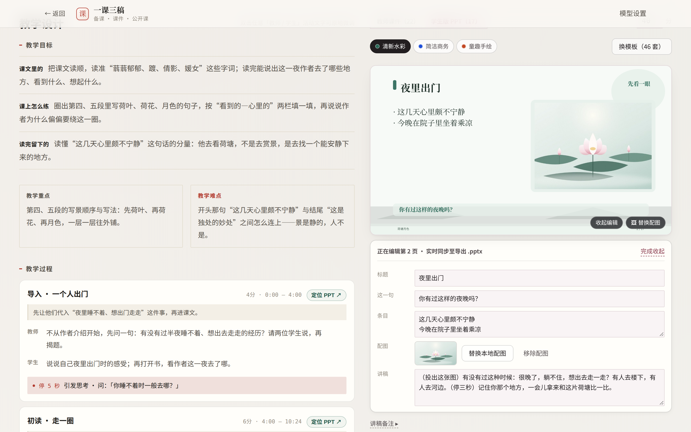
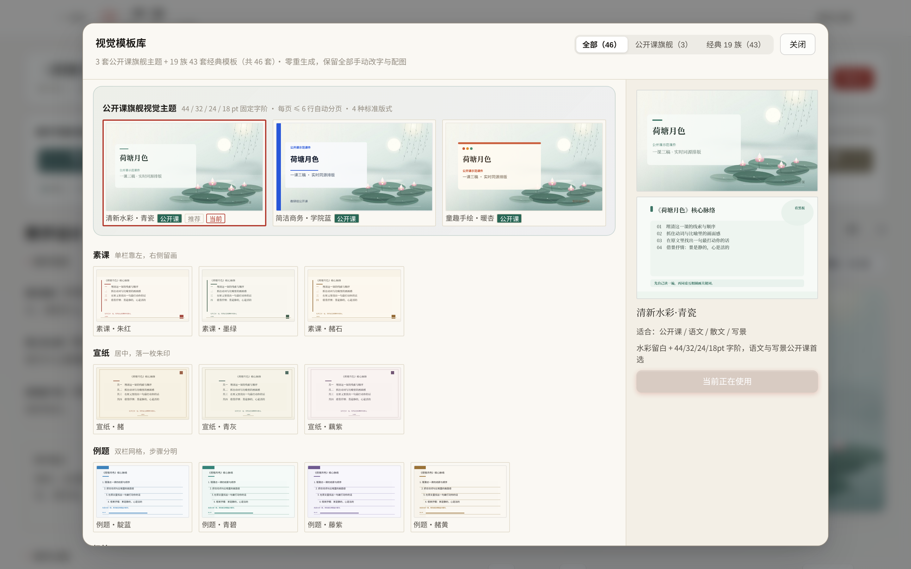
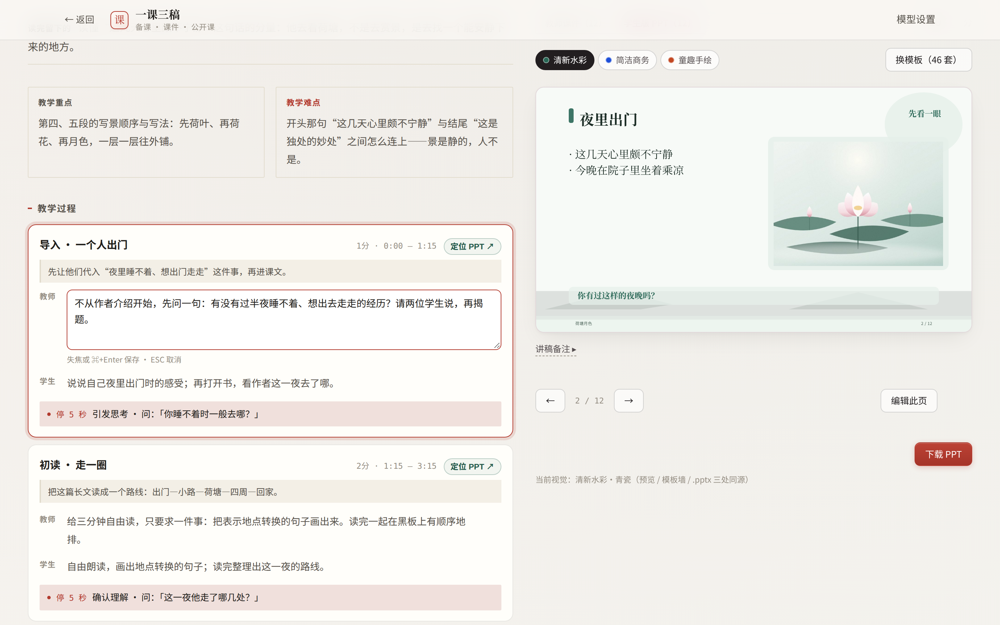
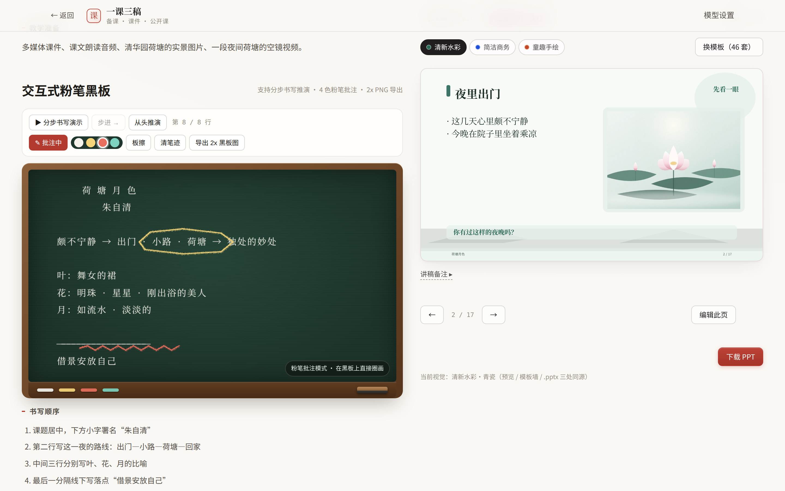
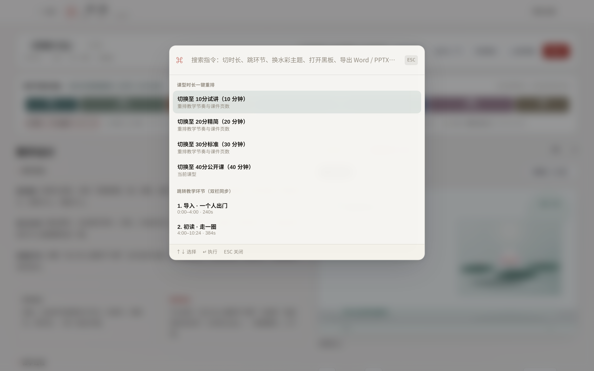
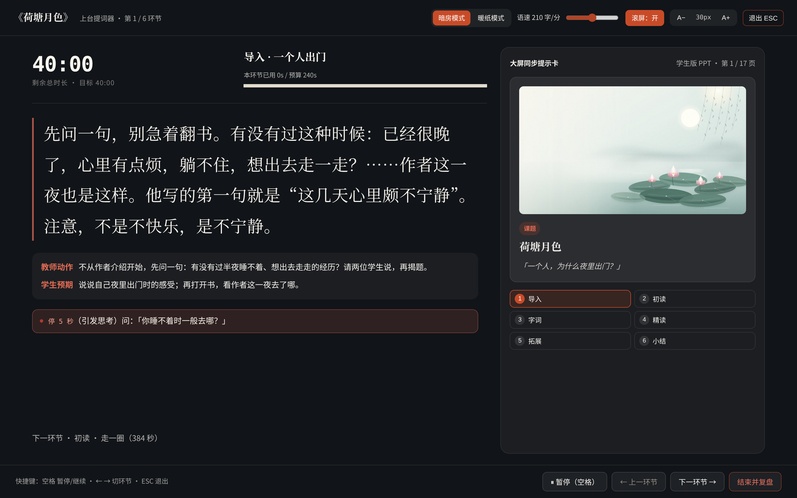

# 《一课三稿》2026 Qoder 高校创造力大赛（StudyHack 赛道）功能实拍展示

> **示范课例**：部编版高中语文高一 · 朱自清《荷塘月色》（第一课时 · 公开课）  
> **运行环境**：纯静态生产构建包（`npm run build` → `dist/`），**免配置 API Key、零后端依赖**，0 秒秒开完整体验，直接适配 **Qoder Sites** 一键部署。

---

## 产品核心理念

不做炫技式的“AI 评委答辩室”或花哨监控雷达，聚焦一线教师与师范生最真实的备课痛点：**写完教案还要重做课件，做完课件还要重排学生 PPT，改一处要改三遍，临时从 40 分钟公开课改成 10 分钟试讲全盘推翻。**

「一课三稿」以 **Editorial Studio 学术生产力工作台** 为底座，把**教学设计、教师版课件、学生版公开课 PPT、粉笔黑板、上台提词器**收进同一份同源数据模型——老师在任意一处原地微调文字或替换 16:9 配图，都会实时进入导出的 Word（`.doc`）、`.pptx`、Markdown 与提词器。

---

## 8 大核心功能高清实拍（以《荷塘月色》为例）

### 1. Editorial Studio 极简大留白首屏 & 精选示范课画廊

采用 Perplexity / Apple 风格的极简学术刊物首屏：精致眉标、渐变衬线主标题、磨砂浮起一体化备课输入框，内置 **10分试讲 / 20分精简 / 30分标准 / 40分公开课** 快捷课型胶囊与可折叠课文原文抽屉；下方 3 列精选示范课画廊自带学段学科标签与预置 16:9 无字水彩/几何封面图，免 API Key 点击 0 秒直达工作台。

---

### 2. 《荷塘月色》工作台全景：公开课「清新水彩」视觉系统 + 莫兰迪时间轴

进入《荷塘月色》40 分钟公开课工作台：
- **顶部极简控制条**：四档课型一键切换胶囊、`⌘K` 指令台入口、粉笔黑板入口、上台提词器入口、统一下拉「导出 ▾」菜单（收口 Word / 教师版 PPTX / 学生版 PPTX / Markdown / 复制全稿 / 全屏演示 / 打印）；
- **非线性教学节奏时间轴**：按分钟比例排布的莫兰迪学术色块，直观呈现 6 大教学环节时长配比；
- **右侧「清新水彩」公开课封面**：预置 16:9 无字月下荷塘水彩插画满版铺底（字压图上），44/32/24/18pt 四档固定字阶，与模板墙、导出 `.pptx` 100% 同源一致。

---

### 3. 学生版 PPT 图文并排 + 点击画面直接编辑 & 本地上传 16:9 配图

翻至《荷塘月色》内页，自动命中**图文并排（`split`）**标准版式：左侧遵循每页 ≤ 6 行、每行 ≤ 18 字（超限自动分页），右侧呈现预置 16:9 荷塘特写水彩插画。
- **零门槛直接交互**：点击 PPT 画面直接展开编辑面板，点击画面内插画直接触发本地换图；
- **完整配图管线**：每页支持本地上传 / 替换 / 移除配图，自动中心裁切压缩为 16:9（1280×720 JPEG），写入 `edits.ts` 的 `SlidePatch.illustration`，支持 **40 步撤销**、**换模板保留**并直接嵌入导出的 `.pptx`。

---

### 4. 视觉模板墙（Portal 挂载）：3 套公开课旗舰主题 + 19 族 43 套经典模板

点击「换模板（46 套）」通过 `React.createPortal(..., document.body)` 居中打开视觉模板墙（绝不被父容器层叠上下文或动画遮挡）：
- 顶部置顶 3 套公开课旗舰视觉主题：**清新水彩 (`watercolor`)**、**简洁商务 (`business`)**、**童趣手绘 (`handdrawn`)**；
- 下方完整保留原有 **19 族 43 套**经典模板（共 **22 族 46 套**），全部由同一份 `place()` 引擎实时渲染，零网络请求、保留老师全部手动改字与配图。

---

### 5. 一键切换「10分试讲」非线性节奏重排 + 双栏联动 & 教案原地微调

点击顶部「**10分试讲**」胶囊，莫兰迪教学节奏时间轴触发弹簧过渡动画，全案自动重排为 10 分钟试讲骨架：
- 点击时间轴色块或左侧环节卡片右上角的「**定位 PPT ↗**」，左侧教学设计平滑滚动高亮，右侧教师课件与学生版 PPT 同步跳至对应页；
- **双击左侧任意「教师 / 学生」活动文字**即可原地微调编辑，失焦或 `⌘+Enter` 保存后，修改内容自动同步进入导出的 Word / Markdown / 复制全稿与上台提词器。

---

### 6. 交互式粉笔黑板画布：分步书写推演 + 颗粒感粉笔批注 + 2x 高清 PNG 导出

将传统静态纯文本板书升级为高拟真墨绿石板黑板 + 暖木质粉笔槽：
- **分步书写演示**：按板书书写顺序逐行粉笔动画推演，支持暂停、步进、从头推演；
- **HTML5 Canvas 颗粒感粉笔批注**：支持纯白 / 暖黄 / 朱红 / 青瓷 4 色真实颗粒笔触圈画 + 板擦 + 清空笔迹；
- **一键导出 2x 高清黑板 PNG 图**：将板面、木框、板书文字与老师手写粉笔批注合成为高清图片下载。

---

### 7. Linear 级 `⌘K` 全局备课指令面板

在工作台任意位置按下 `Cmd+K` / `Ctrl+K`（或点击顶栏「指令台 ⌘K」），毛玻璃全局指令台经由 Portal 居中弹出，支持中英文模糊搜索与方向键直达：
- 一键切换 10/20/30/40 分钟课型时长；
- 快速跳转任意教学环节（双栏同步定位）；
- 秒切三大公开课视觉主题（清新水彩 / 简洁商务 / 童趣手绘）；
- 快速打开模板墙 / 定位粉笔黑板 / 启动上台提词器 / 执行全部导出动作。

---

### 8. 专业级上台提词器（暗房 / 暖纸双模式 + 自动滚屏 + 大屏 PPT 提示卡）

为试讲、公开课与教资面试打造的演播级上台提词器（Portal 全屏挂载）：
- **暗房 / 暖纸双视觉模式**一键切换；
- **`requestAnimationFrame` 平滑自动滚屏**：配备 **150–270 字/分** 语速滑杆与滚屏开关；
- **便捷讲台操控**：字号无级调节（`A−` / `A+`）、空格键暂停/继续、左右方向键切环节、`ESC` 退出；
- **右侧同步大屏 PPT 提示卡**：实时呈现当前环节对应的学生版 PPT 画面、要点与停顿追问，演练结束后自动生成逐环节时间偏差复盘报告。

---

## 技术验证清单

- `npx tsc --noEmit`：0 报错通过 TypeScript 严格检查
- `npm run typecheck:scripts`：0 报错通过全部脚本类型检查
- `npm run build`：Vite 生产构建零报错，纯静态 `dist/` 可直接部署至 Qoder Sites
- `npm run check` / `check:wall` / `check:scale` / `check:deck-edit` / `check:session` / `check:nokey`：全部自动化门禁通过，前端与构建产物零密钥泄露
